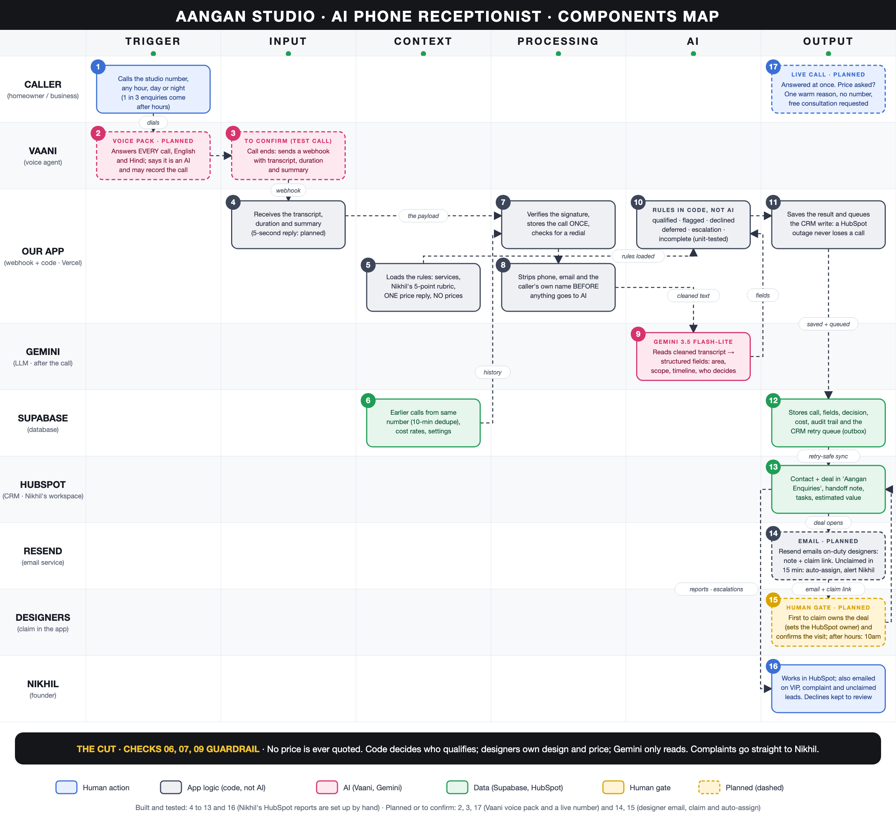

# Components Map: Aangan Studio phone receptionist

MESA Case 03. Phone calls only (WhatsApp and the web form are out of scope; the same pipeline would extend to them by
swapping the Trigger and Input columns). Status: **built and tested**, **planned**, or **depends on Vaani (to confirm)**.
The same content is the home page of the deployed site (source: `src/lib/components-map.ts`).

| Column | What |
|---|---|
| **1. Trigger** | A caller dials the studio number at any hour; a Vaani voice agent answers every call (English/Hindi) *(depends on Vaani)*. When the call ends, Vaani sends a signed webhook (`call_postprocessing`) to `POST /api/webhooks/vaani` *(built)*. |
| **2. Input** | Full transcript (AGENT/USER lines), call id, duration, end reason, recording link *(built)*. Caller number and start time are not in the post-call event; they come from the earlier `call_started` event or Vaani's call API *(to confirm with a real test call)*. |
| **3. Context** | `services.md` (service area Pune + PCMC, in/out-of-scope projects), `qualified.md` (Nikhil's 5-criterion rubric and what does not disqualify), the single allowed pricing reply (**no pricing numbers are loaded anywhere**), earlier calls from the same number in the last 10 minutes (dedupe), settings for value and cost rates *(all built)*. |
| **4. Processing** | Verify signature and store the call once (idempotent); strip phone numbers, emails and the caller's own name before any AI call; apply Nikhil's rubric in plain unit-tested code to reach qualified / qualified with flags / declined (reason) / deferred (revisit date) / escalation / incomplete; dedupe a dropped call and its redial; compute per-call cost; queue the CRM write with retries *(all built)*. Reply to Vaani within its 5-second limit and process in the background *(planned)*. |
| **5. AI** | Live conversation: Vaani voice agent *(depends on Vaani)*. After the call: Gemini 3.5 Flash-Lite extracts structured fields; the cheapest model that passed, **20/20** historical calls matched the intended outcome (**10/10 held out**) *(built)*. The qualify/decline/escalate decision is deliberately **not** AI. |
| **6. Output** | Caller: answered at once, no price quoted, free consultation offered. HubSpot: contact, deal in the "Aangan Enquiries" pipeline (estimated value on qualified leads only), handoff note, tasks for callbacks/revisits/urgent escalation *(built and live-tested on a test portal)*. Email (Resend): on-duty designers get the handoff note and a claim link; first claim becomes the HubSpot deal owner and confirms the visit; unclaimed after 15 minutes it is auto-assigned and Nikhil is alerted; after-hours leads wait until 10:00 IST; Nikhil is also emailed on VIP, complaint and unclaimed leads *(planned)*. Founder: HubSpot reports for pipeline and cost vs value, plus a thin console for declined-lead review, costs and replay tests *(planned)*. |

## The Cut

**Asked for:** "the system should quote our standard per-square-foot pricing."
**Not built.** It fails check 6 (failure risk) and check 9 (clear owner): a wrong or stale number has no accountable
person, and the pricing guide itself forbids quoting. The agent gives one warm deflection with a reason and books the free
consultation. In the historical calls, both callers who pushed for a price still booked.

## Evidence the pipeline works

- 158+ automated tests pass (rules, pipeline, HubSpot sync, webhook, replay).
- Replay of the 20 historical phone enquiries with the real model: 20/20 intended outcomes (10 prompt-example, 10 held-out).
- Live tests: one fake lead through the real HubSpot portal and the real Supabase database, then cleaned up.
